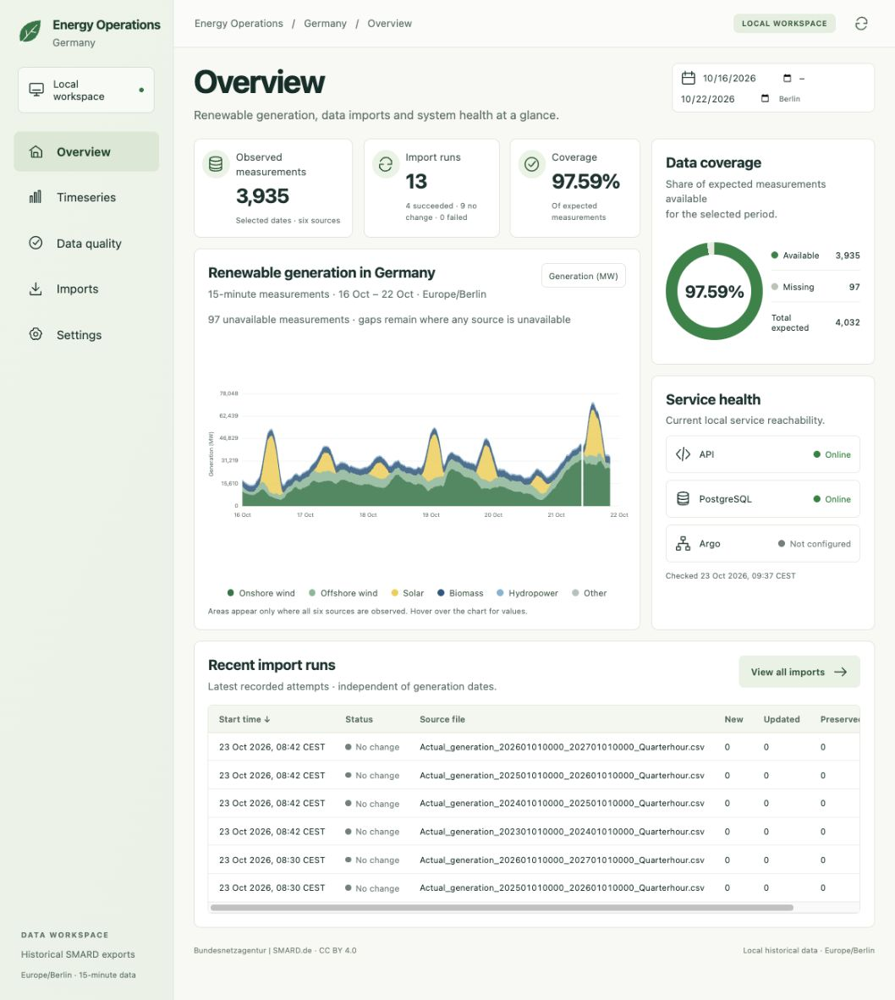
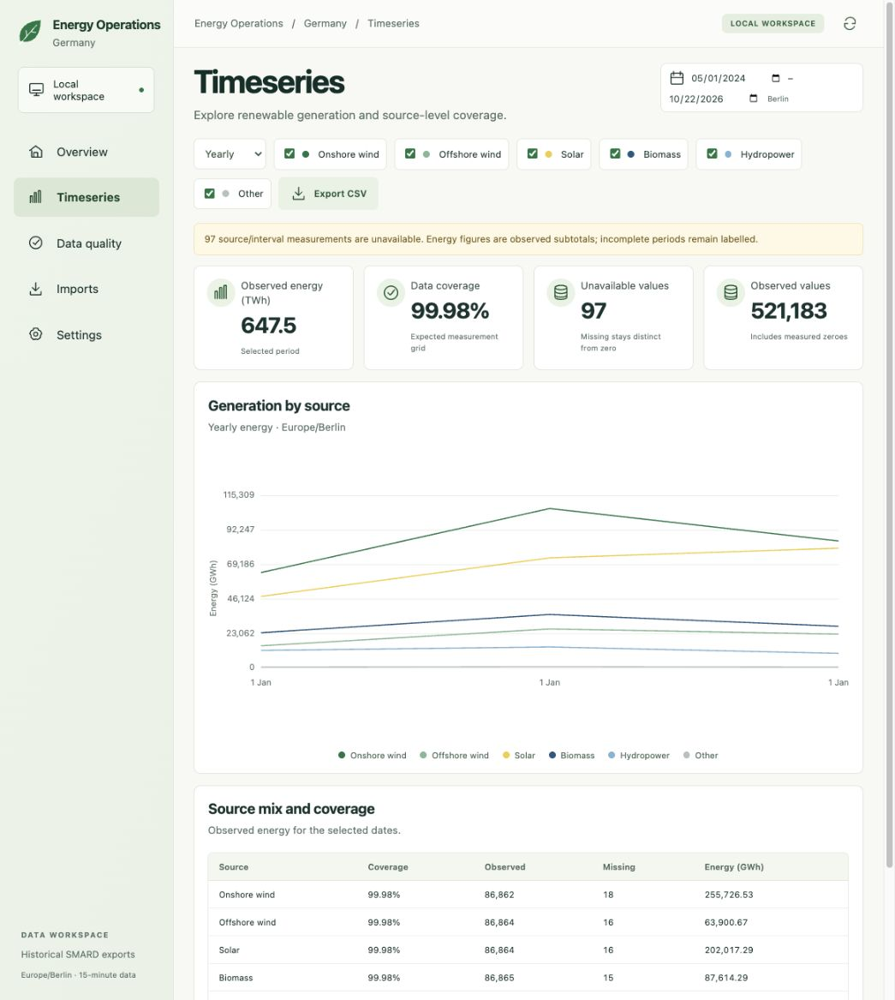

# Renewable Energy Operations

A Python project for exploring Germany’s renewable electricity generation and monitoring the quality of the data behind it.

The goal is to turn public SMARD data into reliable time series that analysts can explore and operators can maintain—from importing a CSV to investigating a failed update.

> **Current stage: working local dashboard.** Validated SMARD exports load into PostgreSQL and are served through FastAPI to a custom HTML/CSS/JavaScript dashboard. Workflow scheduling and cloud deployment are later milestones.

## Open the dashboard

With the local services running:

- **Dashboard:** [localhost:18501](http://127.0.0.1:18501)
- **API documentation:** [localhost:18000/docs](http://127.0.0.1:18000/docs)

## Dashboard preview

The custom web UI uses a forest-green and sage workspace with generation analysis at the centre and coverage and service health alongside it. Use the left sidebar to move between pages; the refresh icon reloads data and health checks. Click either preview below to open the corresponding section of the [dashboard UI guide](docs/dashboard-guide.md).

[](docs/dashboard-guide.md#overview)

| Page | What you can do |
|---|---|
| **[Overview](docs/dashboard-guide.md#overview)** | Explore generation for selected dates, check coverage and service health, and inspect recent imports. |
| **[Timeseries](docs/dashboard-guide.md#timeseries)** | Filter by date range and energy source; compare daily, monthly, or yearly generation; download aggregates as CSV. |
| **[Data quality](docs/dashboard-guide.md#data-quality)** | Inspect coverage across the selected period and review timestamp-normalization notes. |
| **[Imports](docs/dashboard-guide.md#imports)** | Search filenames, filter execution phases, and inspect publication counts and recorded failures. |
| **[Settings](docs/dashboard-guide.md#settings)** | View the current local configuration, timezone, units, and API address. |

[](docs/dashboard-guide.md#timeseries)

Incomplete periods are labelled as **observed subtotals**. Argo scheduling is marked **Not configured** until orchestration is implemented. Screenshots show real local data captured on 23 October 2026: Overview uses 16–22 October 2026; Timeseries shows yearly aggregates for 1 May 2024–22 October 2026. The boundary years are partial. Counts change as data is imported.

See the [dashboard UI guide](docs/dashboard-guide.md) for a walkthrough of the controls and metric definitions, or the [local runbook](docs/local-runbook.md) to start the services.

## What will this project do?

The platform is being built to answer four questions:

- How much electricity comes from wind, solar, and other renewable sources?
- How does generation change by day, month, and year?
- Where is data missing, duplicated, or inconsistent?
- Which imports failed, and how can they be rerun safely?

The main engineering challenges are handling clock changes correctly, keeping missing values distinct from zero, and updating data without creating duplicate records.

## Data

The project uses **German actual-generation exports from [SMARD](https://www.smard.de/en/downloadcenter/download-market-data)** at **15-minute intervals**, measured in **MWh**.

It covers biomass, hydropower, offshore wind, onshore wind, solar photovoltaics, and other renewables. The initial downloaded files cover **2023–2025 and part of 2026**. Full datasets are kept outside Git.

Source: **Bundesnetzagentur | SMARD.de**, under [CC BY 4.0](https://creativecommons.org/licenses/by/4.0/). See the [data contract](docs/data-contract.md) for timestamp, unit, and missing-value rules.

## Data flow

```text
SMARD CSV files
      ↓
Python — read, validate, and normalize
      ↓
PostgreSQL — store generation data and import history
      ↓
FastAPI — provide access to the data
      ↓
HTML / CSS / JavaScript — charts, coverage, and import monitoring
```

Later milestones will add **Argo Workflows** for scheduled imports and **Azure Kubernetes Service (AKS)** for deployment. The [architecture notes](docs/architecture.md) explain the design decisions.

## Progress

| Stage | Deliverable | Status |
|---|---|---|
| 1. Foundation | Python package, CLI, tests, and GitHub Actions configuration | Complete |
| 2. Data ingestion | CSV parsing, timeline validation, and clock-change handling | Complete for local exports |
| 3. Storage | PostgreSQL, atomic imports, safe reruns, and correction history | Working locally |
| 4. API and dashboard | Generation queries, charts, quality, and import monitoring | Working locally |
| 5. Operations and deployment | Scheduled jobs, preprod/prod, and recovery checks | Planned |

The current application uses historical local exports. Scheduled retrieval, login, preprod/prod deployment, and operational recovery drills remain planned.

## Quick start

You need **Git, Python 3.11+, and Docker Desktop**. The commands below are for macOS/Linux. No frontend build or npm installation is needed to run the dashboard. Node.js 22+ is needed only to run the JavaScript tests.

```bash
git clone https://github.com/larrydinh/renewable-energy-operations.git
cd renewable-energy-operations

python3 -m venv .venv
source .venv/bin/activate
python -m pip install -r requirements-dev.txt
python -m pip install --no-build-isolation --no-deps -e .

energy-ops --help
python -m pytest
# Optional frontend data checks (Node.js 22+)
node --test tests/web/*.test.mjs
```

If you already have the repository, start from its directory and skip the first two commands.

Copy `.env.example` to `.env`, choose a local database password, and use the same password in `DATABASE_URL`. Real credentials stay in this ignored file. A configured `.env` already exists on the development laptop.

```bash
# On a new machine, fetch the database image once.
docker pull postgres:17

# First launch: create the database, import the four exports, and start both services.
./scripts/start-local.sh --data-dir ../data/raw/smard

# Later launches: use the already imported database.
./scripts/start-local.sh
```

Keep the terminal running. Ctrl+C stops the API and dashboard; PostgreSQL data persists in a Docker volume. Ports 55432 (database), 18000 (API), and 18501 (dashboard) are bound to localhost. To stop the database too, use `docker compose stop db`.

See the [local runbook](docs/local-runbook.md) for individual commands, tests, backups, and troubleshooting.

## Import a batch of exports

With PostgreSQL running and the schema initialized, import all matching exports from a directory:

```bash
energy-ops import-smard-batch ../data/raw/smard
```

The command reads local midnight boundaries from filenames such as `Actual_generation_202401010000_202501010000_Quarterhour.csv`, then validates each file against that period. It processes files in filename order, skips unchanged exports safely, and prints a JSON summary of successful, unchanged, and failed imports. A failed file does not prevent later files from being attempted; successful files remain committed. Exit code **0** means every file succeeded or was unchanged; **1** means an input or import failed.

Corrections still require review and the single-file `import-smard --accept-corrections` command. Batch import reads existing files; it does not download new SMARD data or schedule itself. See the [batch import runbook](docs/local-runbook.md#batch-imports) for reporting and recovery.

## Parse your SMARD files

With the virtual environment active, pass one or more CSV paths:

```bash
energy-ops parse-smard ../data/raw/smard/*.csv
```

This example uses the shared `data/` directory beside the repository. You can pass any explicit local path instead. For each file, the report lists CSV row counts, six renewable measurements per row, and observed, missing, and zero counts by source. A malformed file produces an error with its row and column where applicable; no summary is printed unless all requested files parse successfully.

Try the small included sample with `energy-ops parse-smard tests/fixtures/smard_actual_generation_sample.csv`.

## Validate and normalize timestamps

For a complete export, specify the exact local-date period it contains:

```bash
energy-ops normalize-smard \
  ../data/raw/smard/Actual_generation_202401010000_202501010000_Quarterhour.csv \
  --start-date 2024-01-01 --end-date 2025-01-01
```

The end date is exclusive. This validates the entire file against that period; the dates do not filter a larger file. The JSON report includes UTC coverage, clock-change day counts, and warnings for recognized source end-label discrepancies. Invalid or incomplete timelines fail with an error. Original CSVs are read without modification.

## Development

Application code lives in `src/energy_ops/`, tests in `tests/`, and design notes in `docs/`.

GitHub Actions is configured to run tests, linting, formatting checks, and package builds on Python 3.11–3.13. For the local checks, dependency management, and contribution workflow, see the [development guide](docs/development.md).
