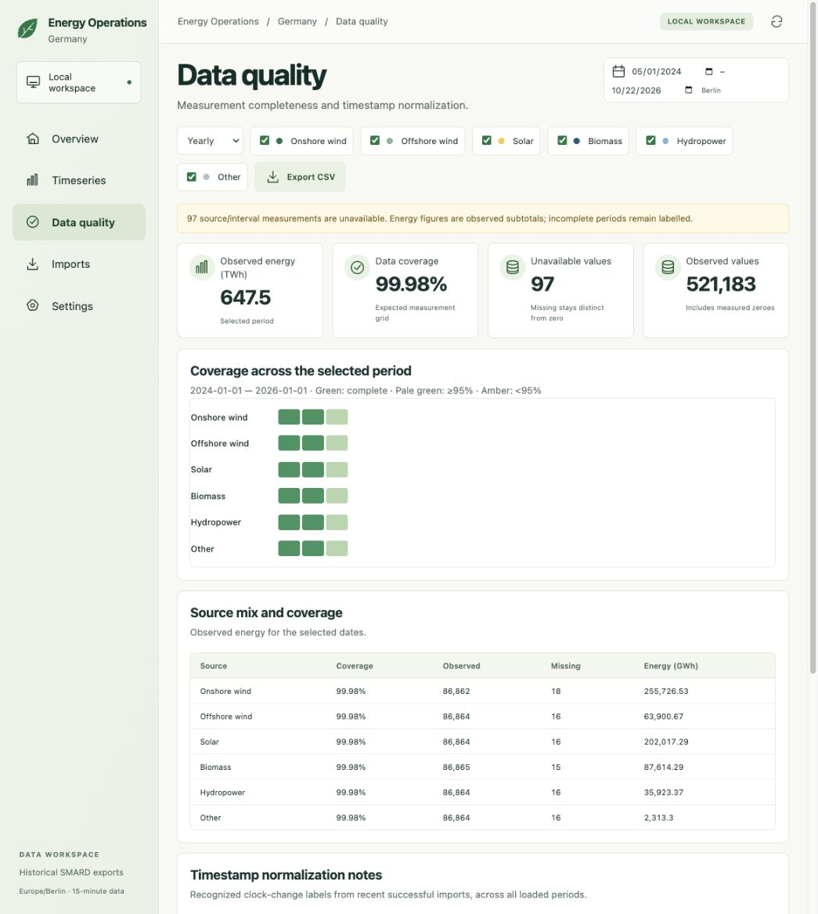
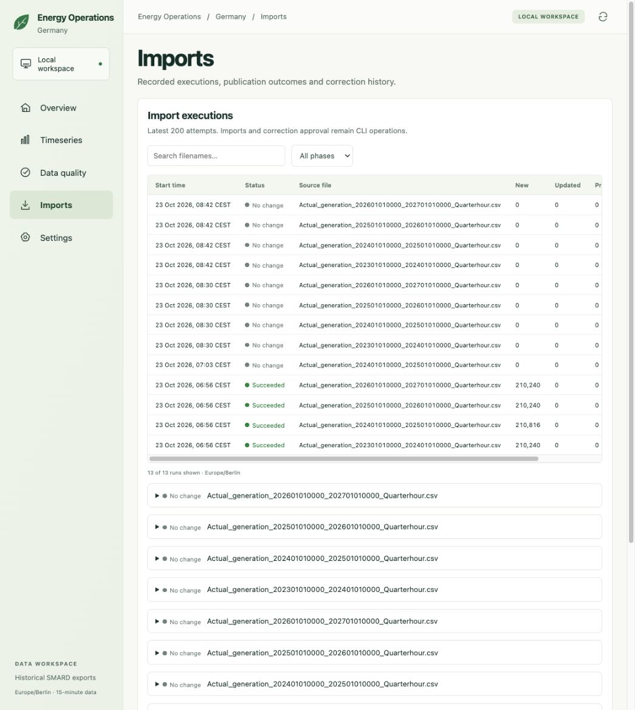
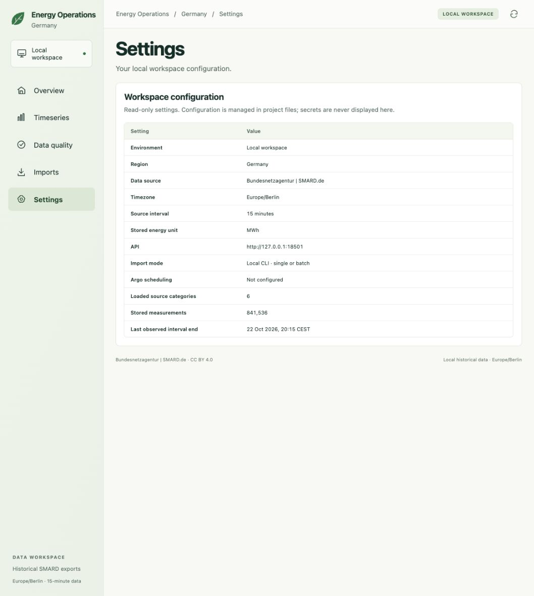

# Dashboard UI guide

[Back to README](../README.md) · [Start the local services](local-runbook.md)

The custom HTML/CSS/JavaScript dashboard reads validated German SMARD data through FastAPI. PostgreSQL stores measurements and import history. The application uses existing local exports; it does not download new measurements or schedule imports.

## Navigation and dates

Use the sage sidebar to open Overview, Timeseries, Data quality, Imports, or Settings. The breadcrumb identifies the current page. The refresh icon reloads measurements, import history, and health checks without importing files.

The start and end date controls apply to Overview, Timeseries, and Data quality; both dates are inclusive in the UI. The default is the latest seven calendar days within observed coverage. The date selection remains when changing views. Imports and Settings do not use the date filter. Browser locale determines the native date-input format, while date boundaries and chart times always use Europe/Berlin.

## Overview

- **Observed measurements** counts available source/interval measurements in the selected dates across six sources. A measured zero is available; a missing value is not.
- **Import runs** counts the latest 200 recorded attempts independently of selected dates, with succeeded, no-change, and failed totals. No change means publication safely left observations unchanged.
- **Coverage** divides available measurements by the expected grid for the selected dates, including the 92/100 quarter-hours on clock-change days. The coverage ring shows available, missing, and expected counts.
- **Renewable generation in Germany** shows 15-minute measurements for selections of at most 31 days. The chart converts MWh per quarter-hour to average MW by multiplying by four. Stacked source areas are drawn only where all six sources have values; unavailable or absent slots create gaps rather than zeroes. If any negative value occurs, the chart uses separate lines. Hover for individual source values. For longer selections, the chart uses daily energy in GWh; incomplete daily periods use separate observed-subtotal lines.
- **Service health** checks local API/PostgreSQL reachability when loading or refreshing. It is a snapshot, not continuous monitoring or a statement about data freshness. Argo is explicitly **Not configured**.
- **Recent import runs** shows the newest six attempts, with filename, outcome, inserted/updated/preserved counts, and elapsed seconds. **View all imports** opens the searchable Imports page. An unfinished run displays “Running” as its duration.

## Timeseries

Choose dates at the top, then choose Daily, Monthly, or Yearly resolution and tick the energy sources. The chart and metrics update together. The headline energy metric uses TWh; the chart and source table use GWh. Incomplete selections are labelled as observed energy subtotals. A partial month/year remains partial; changing resolution does not expand the date range.

Use **Export CSV** to download the current aggregate selection. Exported energy stays in MWh and retains the API's decimal strings. Columns include expected, observed, and missing counts, coverage, and completeness. Expand **Explore aggregate rows** to inspect the exported data in the page. No chart zoom or PNG-export toolbar is implemented in this custom frontend.

## Data quality

The same date, resolution, and source controls drive the coverage heatmap and source table. Hover a cell to see its period and percentage. Green means complete, pale green means at least 95%, and amber means below 95%. Text coverage values remain available in the source table.

Timestamp normalization notes show recognized source-label discrepancies from the latest 200 attempts that succeeded, across all their loaded periods. They do not follow the generation date filter. CSV export contains the same selected aggregate rows as Timeseries.

## Imports

Search for part of a filename and choose a phase to narrow the latest 200 attempts. Start times use Europe/Berlin. Expand a run to inspect its ID, source period, record counts, timestamp notes, and any recorded error. Importing files and approving corrections remain CLI operations; the UI is read-only.

## Settings

Settings displays the local environment, region, timezone, stored unit, API origin, import mode, scheduling status, stored-record count, and latest observed interval end. Configuration is managed in project files. Database credentials are not shown.

## Screenshots and limitations

Screenshots in `docs/screenshots/` show actual local data on 23 October 2026. The Overview preview covers 16–22 October 2026. The Timeseries and Data quality previews use yearly aggregates over 1 May 2024–22 October 2026, so their 2024 and 2026 buckets are partial. Imports and Settings are independent of the generation date range. Counts change after imports. Refresh them with the README after a substantial design change. Relative links let GitHub render the images once committed and pushed.

The frontend includes responsive layouts, semantic navigation, labelled controls, accessible status text, and escaped source text. Service checks are snapshots; authorization, remote hosting, scheduled acquisition, and durable job execution remain later milestones.
